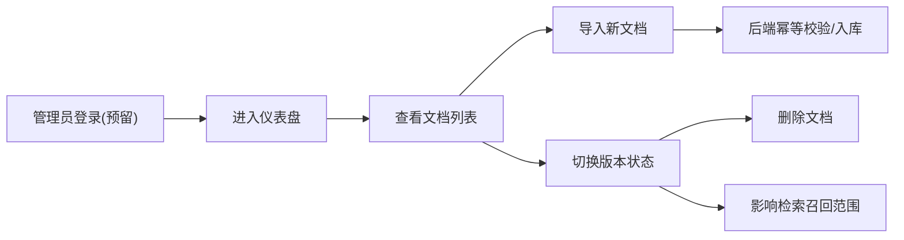

# 管理端后台系统 PRD（SpringKB-RAG Admin Console）

## 1. 产品概述

面向 SpringKB-RAG 知识库的**管理端后台系统**：让知识库管理员能够管理知识文档——按来源/版本查看文档、切换版本启用状态、导入新知识。解决知识治理的核心诉求：**让"哪些内容可以被检索"处于可控状态**。

- 定位：管理端后台（独立前端工程 `frontend/`），纯静态页面，消费后端 `/api/admin/*` 与 `/api/qa/*` 接口。
- 目标用户：知识库管理员（演示环境不做登录鉴权，预留路由）。
- 价值：与用户端问答页共同构成完整系统形态；版本状态切换直接影响检索召回，是 RAG 知识治理能力的可视化落点。

## 2. 核心功能

### 2.1 用户角色

| 角色 | 方式 | 核心权限 |
|------|------|----------|
| 知识库管理员 | 演示环境免登录（预留 `/login`） | 查看文档、导入文档、切换版本状态、删除文档、测试问答 |

### 2.2 功能模块

1. **仪表盘页**：知识库概览（文档总数、chunk 总数、来源分布、版本分布、活跃/停用统计）
2. **文档列表页**：文档表格（来源/版本/标题/状态/chunk 数/更新时间），支持筛选、状态切换、删除、查看 chunk 明细
3. **文档导入页**：导入表单（来源、版本、标题、文档正文；official 支持 URL 抓取、community 支持 SO 元数据字段）

### 2.3 页面详情

| 页面名称 | 模块名称 | 功能描述 |
|---------|---------|---------|
| 仪表盘 | 统计卡片 | 文档数、chunk 数、活跃占比等核心指标卡片 |
| 仪表盘 | 分布图表 | 来源分布（official/community）、版本分布（3.2/3.3） |
| 文档列表 | 筛选栏 | 按来源、版本、状态过滤；关键字搜索 |
| 文档列表 | 数据表格 | 展示文档列表，chunk 数、更新时间等列 |
| 文档列表 | 状态切换 | 行内 switch 切换 active/inactive，即时反馈 |
| 文档列表 | 删除 | 删除确认弹窗，删除文档及其所有 chunk |
| 文档列表 | chunk 明细 | 抽屉/弹窗查看该文档各 chunk 文本与元数据 |
| 文档导入 | 导入表单 | 选择来源/版本，填写标题与正文或 URL，提交导入 |
| 文档导入 | 结果反馈 | 成功/失败/幂等跳过提示 |

## 3. 核心流程

### 3.1 文档导入流程

用户填写导入表单 → 提交 `/api/admin/documents/import` → 后端幂等校验并入库 → 前端提示成功（含跳过/失败原因）。

### 3.2 版本状态切换流程

用户切换文档 active 状态 → 调用 `PATCH /api/admin/documents/{docId}/active` → 前端乐观更新 + 反馈。

## 4. 用户界面设计

### 4.1 设计风格

- **主色**：深青色（teal/emerald 系，`#0F766E`），搭配中性灰底（zinc），信息密度高但不压抑
- **辅助色**：状态语义色——活跃=主色、停用=灰、危险操作=红
- **组件基调**：Element Plus 为基础，覆盖定制圆角（8px）、细边框、克制的阴影
- **字体**：中文 `PingFang SC`/`Microsoft YaHei` 栈 + 数字与 ID 用等宽字（`JetBrains Mono`），体现"工程后台"气质
- **布局**：左侧固定导航（图标+文字）+ 右侧内容区；页面内卡片式布局，间距统一 4 的倍数
- **动效**：页面切换淡入、表格行 hover 高亮、状态 switch 过渡，保持克制的微交互

### 4.2 页面设计概览

| 页面名称 | 模块名称 | UI 元素 |
|---------|---------|---------|
| 仪表盘 | 统计卡片 | 卡片+大数字+环比语义色，hover 阴影 |
| 仪表盘 | 分布图表 | 横向条形/环形图（CSS 实现，不引重型图表库） |
| 文档列表 | 筛选栏 | 下拉选择器+输入框+查询/重置按钮 |
| 文档列表 | 数据表格 | el-table + 标签(tag)化来源/版本 + switch + 操作按钮 |
| 文档导入 | 表单 | el-form 分区块（来源/版本/内容），必填校验，提交 loading |

### 4.3 响应式

桌面优先（管理后台以 ≥1280px 为主）；≥768px 保持侧边导航，窄屏折叠为顶部导航 + 抽屉。不做移动端深度适配。

## 5. 非功能要求

- 接口失败有明确 toast 反馈；列表加载有骨架屏
- 删除等危险操作必须有二次确认
- 所有 API 交互走统一封装的 axios 实例（含错误拦截）
- 页面 ≤3 个，功能复杂度向内收敛，不引入重型图表库
