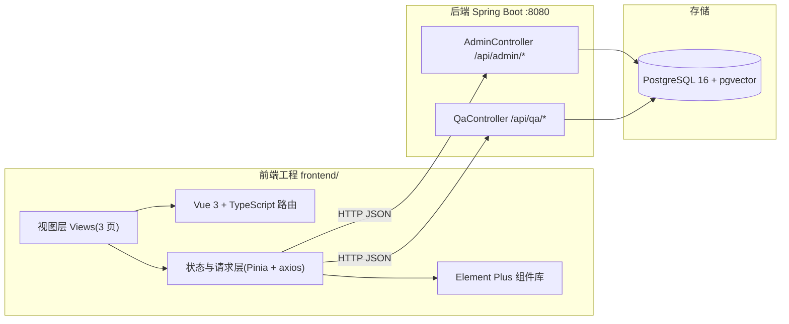
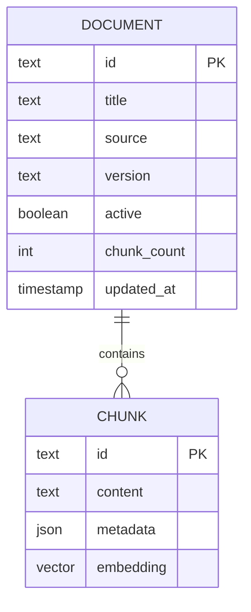

# 管理端后台系统 技术架构（SpringKB-RAG Admin Console）

## 1. 架构设计



开发期：Vite dev server（默认 5173）通过 proxy 转发 `/api/*` 到 `http://localhost:8080`。
构建期：`vite build` 产物 `frontend/dist`，后续由后端 `static/` 或独立 nginx 托管（部署形态待定，不阻塞开发）。

## 2. 技术说明

- 前端：**Vue 3 + TypeScript + Vite + Element Plus + Vue Router + Pinia + axios**
- 初始化工具：`npm init vite-init@latest`（`vue-ts` 模板），工作目录 `frontend/`
- 后端：现有 Spring Boot 4.0.8 应用（仅消费其 REST API，不改造）
- 数据库：PostgreSQL 16 + pgvector（后端托管，前端不直连）
- 包管理器：npm（本机未装 pnpm）

## 3. 路由定义

| 路由 | 页面 | 用途 |
|------|------|------|
| `/` | Dashboard 仪表盘 | 知识库概览统计 |
| `/documents` | DocumentList 文档列表 | 列表/筛选/状态切换/删除/chunk 明细 |
| `/documents/import` | ImportDocument 文档导入 | 导入表单 |
| `/login`（预留） | Login | 登录（本期不实现） |

## 4. API 定义

统一响应：`{ code: 0, message: "ok", data: T }`（code=0 成功）。

### 4.1 文档管理

```
GET    /api/admin/documents?source=&version=&active=&keyword=
       → data: Document[]
POST   /api/admin/documents/import   body: ImportRequest
       → data: { imported: boolean, skipped: boolean, docId: string }
PATCH  /api/admin/documents/{docId}/active  body: { active: boolean }
       → data: Document
DELETE /api/admin/documents/{docId}
       → data: null
GET    /api/admin/documents/{docId}/chunks
       → data: Chunk[]
```

### 4.2 TypeScript 类型定义

```ts
interface Document {
  id: string
  title: string
  source: 'official' | 'community'
  version: '3.2' | '3.3'
  active: boolean
  chunkCount: number
  createdAt: string
  updatedAt: string
}

interface Chunk {
  id: string
  content: string
  metadata: Record<string, string>
  score?: number
}

interface ImportRequest {
  source: 'official' | 'community'
  version: '3.2' | '3.3'
  title: string
  docKey: string
  text: string
  url?: string          // official 抓取时可选
  soQuestionId?: string // community 时填写
  soScore?: string
}
```

### 4.3 仪表盘聚合（本期用列表数据前端聚合，不新增接口）

仪表盘统计由 `GET /api/admin/documents` 全量数据在前端聚合得到（数据规模小，可接受；后续量大再下沉为聚合接口）。

## 5. 前端工程结构（`frontend/`）

```
frontend/
  ├── index.html
  ├── package.json
  ├── tsconfig.json
  ├── vite.config.ts          # 含 /api proxy → localhost:8080
  └── src/
      ├── main.ts             # 挂载 Element Plus、路由、Pinia
      ├── App.vue             # 侧边导航布局
      ├── router/index.ts     # 路由表
      ├── api/
      │   ├── http.ts         # axios 实例 + 拦截器
      │   └── document.ts     # 文档相关 API
      ├── stores/
      │   └── document.ts     # Pinia：文档列表/筛选状态
      ├── views/
      │   ├── Dashboard.vue
      │   ├── DocumentList.vue
      │   └── ImportDocument.vue
      ├── components/         # 通用组件（统计卡片、分布条等）
      ├── composables/        # use* 逻辑抽取
      └── styles/             # 主题变量、Element Plus 覆盖
```

## 6. 数据模型

### 6.1 模型关系



### 6.2 数据说明

- 模型完全对应后端 [详细设计.md](../../docs/详细设计.md) 的 `kb_document` 与 `vector_store` 设计，前端仅为只读/操作视图。
- 本期不新增任何数据库表；仪表盘聚合数据基于现有文档接口。
