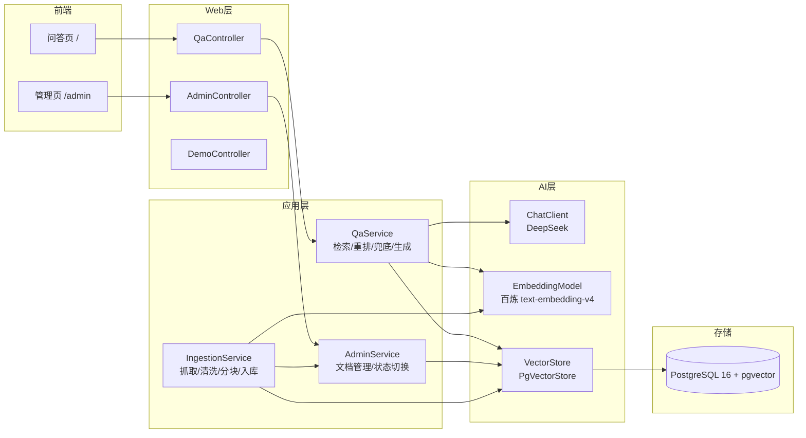

# SpringKB-RAG 详细设计

**版本**：v1.0（2026-10-19）
**关联文档**：[项目计划书.md](项目计划书.md)
**技术基线**：Spring Boot 4.0.8 + Spring AI 2.0.0 + PostgreSQL 16 + pgvector

---

## 1. 文档目的与范围

本文档给出 SpringKB-RAG 的**模块划分、接口设计、数据库设计、核心能力算法与数据获取方案**，作为后续编码与验收的依据。

范围覆盖：检索/问答核心链路、版本过滤、权威性加权、无答案兜底、引用溯源、数据获取导入、最简管理界面、部署配置。

---

## 2. 总体架构

### 2.1 架构图



### 2.2 分层职责

| 层     | 职责                                           | 关键类（规划）                                                                                  |
| ------ | ---------------------------------------------- | ----------------------------------------------------------------------------------------------- |
| Web 层 | HTTP 入站，参数校验、响应封装                  | `QaController`、`AdminController`、`DemoController`（现状）                               |
| 应用层 | 编排检索链路、重排、兜底、文档管理、数据导入   | `QaService`、`AdminService`、`IngestionService`                                           |
| AI 层  | 向量检索、向量化、大模型生成（Spring AI 组件） | `VectorStore`(PgVectorStore)、`EmbeddingModel`、`ChatClient`（现状 `ChatClientConfig`） |
| 存储层 | 向量与业务数据                                 | `vector_store`、`kb_document` 表                                                            |

### 2.3 技术选型（现状确认）

| 组件      | 选型                                                        | 说明                             |
| --------- | ----------------------------------------------------------- | -------------------------------- |
| Chat      | DeepSeek `deepseek-chat`（官方 starter）                  | 国内可用、成本低                 |
| Embedding | 阿里云百炼 OpenAI **兼容模式** `text-embedding-v4`  | 维度 1024 固定；替换需重建向量表 |
| 向量库    | pgvector（`pgvector/pgvector:pg16`，Docker Compose 托管） | 元数据与向量同表，过滤即 WHERE   |
| 检索      | Spring AI PgVectorStore + Filter Expression                 | 版本/状态过滤在查询层执行        |

---

## 3. 模块划分

| 模块      | 包（规划）                           | 职责                                                                    | 状态             |
| --------- | ------------------------------------ | ----------------------------------------------------------------------- | ---------------- |
| demo      | `com.guangqian.springkb.demo`      | 假数据灌入（`FakeDocumentSeeder`）、冒烟接口（`RagDemoController`） | **已实现** |
| kb 核心   | `com.guangqian.springkb.kb`        | 检索（版本过滤）、重排（权威性加权）、兜底、生成、引用封装              | 待实现           |
| ingestion | `com.guangqian.springkb.ingestion` | Spring 文档抓取（Jsoup）、SO CSV 导入、清洗、分块、幂等入库             | 待实现           |
| admin     | `com.guangqian.springkb.admin`     | 文档列表/上传/版本状态切换的 REST 接口 + Thymeleaf 管理页               | 待实现           |

> 设计决策：管理界面采用 **Thymeleaf 服务端渲染**（单页面），保持"后端项目"定位，不引入前端工程链。

---

## 4. 数据库设计

### 4.1 数据模型总览

```
kb_document (文档级，管理/幂等)
  1 ──── n   vector_store (chunk 级，向量检索)
             通过 metadata.doc_id 关联
```

### 4.2 `vector_store`（现状，Spring AI PgVectorStore 默认表）

| 列        | 类型         | 约束 | 说明                                                           |
| --------- | ------------ | ---- | -------------------------------------------------------------- |
| id        | text         | PK   | 应用生成，格式 `{docId}-{chunkIdx}`（现状为 `fake-doc-*`） |
| content   | text         |      | chunk 文本                                                     |
| metadata  | json         |      | 元数据（见 4.4 规范）                                          |
| embedding | vector(1024) |      | 向量，维度固定 1024                                            |

索引（现状）：

```sql
CREATE INDEX spring_ai_vector_index ON public.vector_store
  USING hnsw (embedding vector_cosine_ops);
```

> **硬约束**：`vector(1024)` 维度与 `text-embedding-v4` 绑定，换模型必须 `DROP` 重建本表并重新入库。

### 4.3 `kb_document`（文档级元数据，字段依据真实文档站样本修订）

> 2026-10-19 依据爬取的真实文档元数据（vuejs.org / docs.spring.io 样本，见 [开发日志](./devlog/2026-10-19.md)）修订：新增 `product` / `language` / `doc_type` / `last_modified`，并把「来源站点」与「权威性」拆分为 `origin` + `authority`。

| 列           | 类型        | 约束                        | 说明                                             |
| ------------ | ----------- | --------------------------- | ------------------------------------------------ |
| id           | text        | PK                          | 文档 ID，如 `spring-boot-4.2-SNAPSHOT-actuator-auditing` |
| product      | text        | NOT NULL                    | 产品线：`spring-boot` / `spring-ai` / `vue`      |
| title        | text        | NOT NULL                    | 文档标题                                         |
| origin       | text        | NOT NULL                    | 来源站点：`spring.io` / `vuejs.org` / `stackoverflow` |
| authority    | text        | NOT NULL DEFAULT 'official' | 权威性：`official` / `community`                |
| version      | text        | NOT NULL                    | `4.2-SNAPSHOT` / `3.x` / `latest`               |
| doc_key      | text        | NOT NULL                    | 业务唯一键：URL 相对路径（官方）；SO 问题 ID（社区） |
| doc_type     | text        | NOT NULL DEFAULT 'reference'| `guide` / `api` / `tutorial` / `reference` / `howto` |
| language     | text        | NOT NULL DEFAULT 'en'       | 文档语言：`en` / `zh`                            |
| section      | text        |                             | 章节：`actuator` / `essentials`                 |
| active       | boolean     | NOT NULL DEFAULT true       | 版本/文档启用状态                                 |
| last_modified| timestamptz |                             | 源站最后修改时间（sitemap lastmod，增量更新）     |
| fetched_at   | timestamptz | NOT NULL DEFAULT now()      | 本系统抓取入库时间                               |
| chunk_count  | integer     | NOT NULL DEFAULT 0          | chunk 数（冗余，用于列表展示）                   |
| created_at   | timestamptz | DEFAULT now()               |                                                  |
| updated_at   | timestamptz | DEFAULT now()               |                                                  |

```sql
CREATE UNIQUE INDEX uk_kb_document ON kb_document (product, origin, authority, version, doc_key);
```

**幂等策略**：导入前按 `(product, origin, authority, version, doc_key)` 查 `kb_document`，存在则跳过。

### 4.4 `vector_store.metadata` 字段规范

| 字段           | 类型 | 来源      | 说明                                                                       |
| -------------- | ---- | --------- | -------------------------------------------------------------------------- |
| doc_id         | text | 全模块    | 关联 `kb_document.id`                                            |
| product        | text | 全模块    | 产品线：`spring-boot` / `spring-ai` / `vue`                       |
| origin         | text | 全模块    | 来源站点：`spring.io` / `vuejs.org` / `stackoverflow`           |
| authority      | text | 全模块    | `official` / `community`                                        |
| version        | text | 全模块    | `4.2-SNAPSHOT` / `3.x`                                          |
| active         | text | 全模块    | `"true"` / `"false"`，chunk 级冗余，用于向量查询层过滤；由文档状态同步 |
| doc_type       | text | 全模块    | `guide` / `api` / `tutorial` / `reference` / `howto`           |
| language       | text | 全模块    | `en` / `zh`                                                     |
| title          | text | 全模块    | 文档标题                                                          |
| section        | text | 全模块    | 章节，如 `actuator` / `essentials`                             |
| so_question_id | text | community | SO 问题 ID                                                      |
| so_score       | text | community | SO 答案评分（字符串，如 `"42"`）                                |
| demo           | text | demo      | `"true"` 标识假数据（现状已有）                                 |

> 说明：metadata 为 json 列，过滤时 Spring AI 会生成 `metadata ->> 'version' = '3.3'` 形式的 WHERE 条件。

### 4.5 `kb_chunk` 文档块表（2026-10-19 新增）

> 块级原文存储，与 `vector_store` 按 id 1:1 关联；检索命中向量后按 id 回源取原文用于引用溯源。

| 字段             | 类型      | 约束/默认      | 说明                                                                 |
| ---------------- | --------- | -------------- | -------------------------------------------------------------------- |
| id               | text      | PK             | 与 `vector_store.id` 同值，格式 `chunk-{doc_id}-{ordinal}`，1:1 关联 |
| doc_id           | text      | FK→kb_document，ON DELETE CASCADE | 所属文档；文档下线连带清块 |
| ordinal          | integer   | NOT NULL       | 文档内块序号（h1 起 1..n），前端排序 / 锚点定位                        |
| heading_path     | text      | NOT NULL DEFAULT '' | 标题路径 `h1>h2>h3`，溯源定位 + 前端锚点跳转                     |
| content_markdown | text      | NOT NULL       | 展示用原文（保留代码 / 表格 / `` 图片引用）                  |
| content_text     | text      | NOT NULL       | 嵌入用文本（图片替换为 alt+描述，markdown 语法已清洗，供向量化）        |
| token_count      | integer   | DEFAULT 0      | 估算 token（分块预算 500~1000 管控）                                  |
| image_refs       | jsonb     | DEFAULT '[]'   | 图片清单 `[{src, alt, local_path}]`，导入下载后回填                    |
| created_at / updated_at | timestamptz | DEFAULT now() | 审计字段                                              |

唯一约束：`uk_kb_chunk_doc_ordinal (doc_id, ordinal)`。

**设计决策**：
- **id 对齐回源**：检索命中的是 `vector_store` 的向量行（id 即 chunk key），回答引用溯源时 `WHERE kb_chunk.id = ANY(命中ids)` 直取原文，无需映射表
- **双字段分离**：`content_text` 供嵌入（避免 markdown 语法噪声污染向量），`content_markdown` 供前端渲染与 LLM 展示
- **级联删除**：文档下线 `DELETE kb_document` 连带清空 chunk，配合 `vector_store` 按 id 批量删除

---

## 5. 接口设计

### 5.1 统一响应格式

```json
{ "code": 0, "message": "ok", "data": { } }
```

错误码：`0` 成功；`400` 参数错误；`404` 资源不存在；`500` 内部错误。

### 5.2 问答接口

#### POST `/api/qa/ask` — 检索增强问答

Request：

```json
{
  "question": "CDS 在 Spring Boot 3.3 中如何配置？",
  "version": "3.3",
  "topK": 5
}
```

| 字段     | 必填 | 说明                                                                       |
| -------- | ---- | -------------------------------------------------------------------------- |
| question | 是   | 用户问题                                                                   |
| version  | 否   | 目标版本（3.2/3.3）；缺省=所有版本，**多版本需在回答中说明版本差异** |
| topK     | 否   | 送生成的文档数，默认 5                                                     |

Response：

```json
{
  "code": 0,
  "message": "ok",
  "data": {
    "answer": "在 Spring Boot 3.3 中……[1]……[2]",
    "found": true,
    "sources": [
      { "index": 1, "source": "official", "version": "3.3",
        "title": "Spring Boot 3.3 CDS", "section": "deployment/cds",
        "score": 0.72, "snippet": "原文片段……" }
    ]
  }
}
```

- `found=false`：最高相似度 < 0.65，`answer` 为"知识库中未找到相关答案"，不调用模型。

#### GET `/api/qa/search` — 纯检索（调试/演示）

参数：`q`（必填）、`version`（可选）、`topK`（默认 15）。

Response：`data` 为检索结果数组：

```json
{
  "code": 0, "message": "ok",
  "data": [
    { "id": "official-3.3-deployment-cds-0", "content": "……",
      "source": "official", "version": "3.3", "title": "……", "score": 0.72 }
  ]
}
```

> 该接口输出**重排后**的结果，用于验证权威性加权是否生效。

### 5.3 管理接口（admin）

| 方法   | 路径                                    | 说明                                                                 |
| ------ | --------------------------------------- | -------------------------------------------------------------------- |
| GET    | `/api/admin/documents`                | 文档列表。查询参数：`source`、`version`、`active`、`keyword` |
| POST   | `/api/admin/documents/import`         | 导入文档（见 5.3.1）                                                 |
| PATCH  | `/api/admin/documents/{docId}/active` | 切换版本状态，body：`{ "active": false }`                          |
| DELETE | `/api/admin/documents/{docId}`        | 删除文档及其所有 chunk                                               |
| GET    | `/api/admin/documents/{docId}/chunks` | 文档 chunk 列表（引用溯源调试）                                      |

#### 5.3.1 POST `/api/admin/documents/import`

```json
{
  "source": "official",
  "version": "3.3",
  "title": "Spring Boot 3.3 Reference - Web",
  "docKey": "https://docs.spring.io/spring-boot/3.3.x/reference/html/web.html",
  "text": "……（纯文本正文）"
}
```

或 `community` 模式：

```json
{
  "source": "community",
  "version": "3.3",
  "title": "Spring Boot 3.3 CDS startup",
  "docKey": "SO-123456",
  "text": "……",
  "soQuestionId": "123456",
  "soScore": "42"
}
```

流程：`(source, version, docKey)` 幂等校验 → 分块 → 向量化 → 写 `vector_store` → 写/更新 `kb_document`。

### 5.4 页面路由（Thymeleaf）

| 路由       | 页面   | 功能                                     |
| ---------- | ------ | ---------------------------------------- |
| `/`      | 问答页 | 提问（可带版本选择）、展示回答与引用展开 |
| `/admin` | 管理页 | 文档列表、导入表单、版本状态切换         |

### 5.5 Demo 接口（现状保留）

| 方法 | 路径                 | 说明           |
| ---- | -------------------- | -------------- |
| GET  | `/api/demo/search` | 假数据冒烟检索 |
| POST | `/api/demo/ask`    | 假数据冒烟问答 |

> 保留用于冒烟与回归，正式问答以 `/api/qa/*` 为准。

---

## 6. 核心能力详细设计

### 6.1 检索流程（QaService.ask 主流程）

```
1. question → embedding 向量化
2. 初检：vector_store 相似度 topK×3（默认 15），携带 filter：
     版本=version(可选) AND active=true
3. 兜底判定：max(初检 score) < 0.65 → 返回 found=false，结束（不调模型）
4. 重排：score' = score + (source == 'official' ? 0.15 : 0)，降序
5. 截取前 topK(5) 条
6. 组装 prompt（引用编号 [1]..[n] + 来源标注）
7. ChatClient 生成 → 返回 answer + sources
```

### 6.2 版本过滤（能力一）

- filter expression 语义示例：

```
active == 'true' AND version == '3.3'
```

- 指定版本时只召回该版本 chunk；**不指定版本时召回全部活跃 chunk，并在 prompt 中要求模型说明版本差异**。
- 过滤在 pgvector 查询层执行（WHERE 子句），不在应用内存过滤。

### 6.3 权威性加权（能力二）

- 重排公式：`score' = score + (source == 'official' ? 0.15 : 0)`
- 初检取 topK×3，重排后取前 5，官方文档优先于相似度略高的社区答案，但社区答案仍可入围。
- boost 初始 0.15，后续按验证用例校准。

### 6.4 无答案兜底（能力三）

- 判定：初检最高相似度 < 0.65（余弦）。
- 行为：**不调用 Chat 模型**，返回 `found=false` 与"知识库中未找到相关答案"。
- 阈值初始 0.65，通过测试集校准。

### 6.5 引用溯源与 Prompt 设计

系统提示词要点（在 `ChatClientConfig` 中维护）：

```
1. 仅依据提供的参考资料回答，参考资料的引用编号为 [1][2]…；
2. 每个关键结论后标注对应引用编号，格式 [n]；
3. 明确说明信息来源是官方文档(official)还是社区问答(community)；
4. 参考资料中无答案时，回答"知识库中未找到相关答案"；
5. 指定版本时，仅使用该版本资料；未指定版本时，若存在版本差异需说明。
```

- 回答结构：正文 + 引用编号；接口 `sources` 附带原文片段与元数据，供前端展开。

### 6.6 RAG 全链路坑点与对策（2026-10-19 增补）

> 企业知识库从爬取到问答全链路的高危坑点与本项目对策。**分块是地基，优先级最高。**

| 环节 | 坑点 | 本项目对策 |
| --- | --- | --- |
| 爬取 | 导航噪声混入、正文结构丢失、反爬、sitemap 随站点改版变化 | HtmlToMarkdown 白名单剔除 + 结构保留（已落地）；导入阶段限速 / 重试 / UA |
| 分块 | 按字符硬切会截断表格 / 代码 / 句子 → 语义碎片，检索质量崩 | **按 headings 切**（crawler 已产出 `headings` 锚点）；块 500~1000 token；每块带 `heading_path` |
| 嵌入 | 维度不可变（一锤子买卖）；query 与文档异模型会错乱 | text-embedding-v4 1024 维锁定；换模型须重建向量库；统一 embedding 模型 |
| 存储 | 过滤不在 SQL 层做 → 召回后过滤丢最相关 | active / version 过滤下推到 pgvector 的 WHERE 层 |
| 检索 | top-K 过大噪声多、过小漏答案；无相关内容硬编 | top-K + 相似度阈值；低于阈值走「无答案兜底」（§6.4） |
| 生成 | 幻觉编版本号 / API；无引用不可信；上下文超窗 | prompt 约束「只依据检索内容回答」；回答带 chunk 引用（§6.5）；检索块精炼 |

---

## 7. 数据获取与导入设计

### 7.1 Spring 官方文档（Jsoup）

- 来源：`docs.spring.io/spring-boot/{3.2.x|3.3.x}/reference/html/` 的 `web`、`data`、`howto` 章节。
- 流程：URL 列表 → Jsoup 抓取 → 移除导航/脚本/样式 → 正文纯文本 → 固定 token 分块（默认 500 token，含重叠约 50）→ 入库。
- `doc_key = 章节 URL`，元数据含 `section`。
- 目标规模：50-100 chunk。

### 7.2 Stack Overflow（SEDE）

- 通过 Stack Exchange Data Explorer 执行 SQL 导出 CSV：`spring-boot` 标签、**答案评分 ≥5、2023 年后**的问答（问题 ID、标题、正文、评分等）。
- 清洗 HTML → 一条问答为一个 chunk（或长回答按 500 token 分块）→ 入库。
- `doc_key = SO 问题 ID`，元数据含 `so_question_id`、`so_score`。
- 目标规模：200-500 条。

### 7.3 分块策略

- 固定 token 窗口 + 重叠，不引入语义分块（计划书已列为已知限制）。

---

## 8. 配置与环境

### 8.1 关键配置（`application*.yml`）

| 配置项                                               | 值                                                    |
| ---------------------------------------------------- | ----------------------------------------------------- |
| `spring.ai.chat.deepseek.*`                        | DeepSeek Chat（模型 `deepseek-chat`）               |
| `spring.ai.embedding.openai.base-url`              | `https://dashscope.aliyuncs.com/compatible-mode/v1` |
| `spring.ai.embedding.openai.options.model`         | `text-embedding-v4`                                 |
| `spring.ai.vectorstore.pgvector.dimensions`        | 1024                                                  |
| `spring.ai.vectorstore.pgvector.index-type`        | HNSW                                                  |
| `spring.ai.vectorstore.pgvector.distance-type`     | COSINE_DISTANCE                                       |
| `spring.ai.vectorstore.pgvector.id-type`           | TEXT（现状已启用）                                    |
| `spring.ai.vectorstore.pgvector.initialize-schema` | true                                                  |

### 8.2 环境变量

| 变量                  | 用途                                         |
| --------------------- | -------------------------------------------- |
| `DEEPSEEK_API_KEY`  | DeepSeek Chat                                |
| `DASHSCOPE_API_KEY` | 百炼 Embedding（经 `openai.api-key` 注入） |
| 数据库口令            | compose 内网注入，应用不落明文               |

### 8.3 部署

- `docker compose up -d` 启动 `rag-postgres`（63892:5432）与应用。

---

## 9. 非功能要求与已知限制

### 9.1 非功能要求

1. **幂等**：所有入库路径（seeder、import、抓取）重复执行不产生重复数据。
2. **可验证**：三条验证用例（版本过滤/权威性加权/无答案兜底）可复现，结果记录于测试用例文档。
3. **密钥安全**：API Key 只进环境变量，不入代码与库。

### 9.2 已知限制（源自计划书第八节）

1. Spring AI 2.0 生态资料少，以官方文档/Javadoc 为准。
2. 固定 token 分块，未做语义分块。
3. boost/阈值基于少量用例手调，未网格搜索。
4. 数据规模远低于 pgvector 上限；未来千万级需评估迁移 Qdrant/Milvus。
