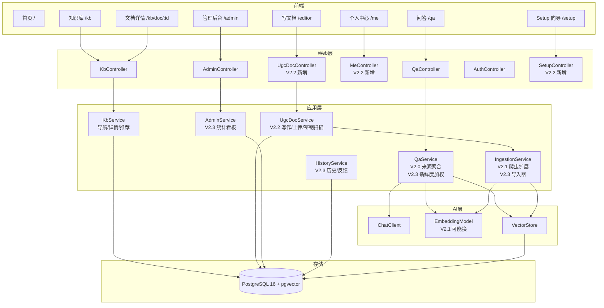

# SpringKB v2 详细设计

**版本**：v2.2（2026-10-20，方向定稿：私有化单实例 + 前端原型已落地）
**前置**：[v2 产品规划.md](./v2产品规划.md)（定位/阶段/不做清单）、v1 详细设计（现状）
**技术基线**：Spring Boot 4.0.8 + Spring AI 2.0.0 + PostgreSQL 16 + pgvector
**当前数据基线**：1445 篇 / 3263 chunks（official 1192：spring-framework 465 / spring-security 156 / spring-boot 73 / spring-ai 80 / spring-data-jpa 35 / vue 80 / vue-router 167 / pinia 97 / vite 39；community 253：Stack Overflow 251 + 2 注入样本）

---

## 1. 文档目的与范围

覆盖 V2.0~V2.4 五阶段的数据模型、接口设计、核心算法、实施步骤与门禁。

| 阶段 | 范围 | 核心交付 | 依赖 |
| --- | --- | --- | --- |
| **V2.0** | 用户体验补全 | 来源聚合 + 原文跳转 + /kb 导航页（左树右卡）+ 文档详情 + 问答页探索增强 + 角标联动 + 检索可解释性 | 无 |
| **V2.1** | 中文 + 数据扩展 | Embedding 双语验证 + 爬虫扩展（235→1500+，已完成 1445）+ 中文检索 | V2.0 |
| **V2.2** | 账户与 UGC 闭环 | admin/member 角色 + setup 向导 + private/team 可见性 + 写文档/上传 + 个人中心 + UGC 加权 + 密钥扫描 | V2.0 |
| **V2.3** | 运营闭环 | 问答历史 + 👍👎反馈 + 命中率/盲区看板 + 新鲜度机制 + 贡献统计 + 导入器 | V2.2 |
| **V2.4** | 轻社交 + 体验 | 点赞 + 收藏（反哺权重）+ PWA + 关联推荐 | V2.3 |

> 架构原则：**单实例单团队，隔离在部署边界**。无 tenant_id、无 RLS、无平台公共区。安全靠「实例级访问控制 + 文档两级可见性 + 发布前密钥扫描」。

---

## 2. 总体架构（v2 更新）



---

## 3. 数据库设计（v2 演进）

### 3.1 V2.0/V2.1：不改 schema

来源聚合是运行时逻辑（§6.1）；爬虫扩展只是往现有表多写数据。

### 3.2 V2.2：UGC 与账户扩展

#### `kb_document` 新增列

```sql
ALTER TABLE kb_document
  ADD COLUMN owner_id        text,                    -- NULL=官方预置/系统导入；否则=作者 user id
  ADD COLUMN authority_src   text NOT NULL DEFAULT 'official',  -- official | ugc | community（检索加权档）
  ADD COLUMN visibility      text NOT NULL DEFAULT 'team',      -- team | private
  ADD COLUMN last_verified_at timestamptz DEFAULT now();        -- V2.3 新鲜度用
CREATE INDEX idx_kb_document_visibility ON kb_document(visibility, active);
CREATE INDEX idx_kb_document_owner      ON kb_document(owner_id);
```

> `authority_src` 与现有 `authority` 字段的关系：爬虫官方文档 authority_src=official；UGC 发布时 authority_src=ugc；SO 等保持 community。检索 boost：official 1.0 / ugc 0.9 / community 0.8。
>
> **vector_store metadata 同步**：导入/发布时写入 `visibility`、`owner_id`、`authority_src`——向量检索 filter 必须强制带可见性条件（§6.2），不能只靠 JOIN。

#### `sys_user` 扩展（V2.2）

```sql
ALTER TABLE sys_user
  ADD COLUMN role       text NOT NULL DEFAULT 'member',  -- admin | member
  ADD COLUMN avatar_url text,
  ADD COLUMN display_name text;
```

> 首个注册用户（setup 向导创建）自动 role=admin。

#### `app_setting`（V2.2，实例级配置）

| 列 | 类型 | 说明 |
| --- | --- | --- |
| key | text PK | `setup_completed` / `instance_name` / `allow_anonymous` |
| value | text | |
| updated_at | timestamptz | |

#### `ugc_draft`（V2.2，可选）

写文档的草稿暂存：id / owner_id / title / content_markdown / updated_at。**MVP 可省略**（前端 localStorage 暂存），发布即入 kb_document。

### 3.3 V2.3：历史、反馈、统计

#### `qa_session`（问答历史 + 反馈）

| 列 | 类型 | 说明 |
| --- | --- | --- |
| id | text PK | |
| user_id | text | 匿名开关开启时可为 null |
| question | text NOT NULL | |
| answer | text | 命中存全文，兜底存 NO_ANSWER 文案 |
| found | boolean | |
| top_sources | jsonb | 前 3 文档级来源摘要（doc_id/title/score） |
| feedback | smallint | 1=👍 / -1=👎 / NULL=未评 |
| feedback_note | text | |
| duration_ms | integer | |
| created_at | timestamptz DEFAULT now() | |

> 异步写入（`@Async`），不阻塞主链路；盲区分析 = `WHERE found=false GROUP BY question`（§6.4）。

### 3.4 V2.4：点赞与收藏

```sql
CREATE TABLE doc_reaction (
  user_id   text NOT NULL,
  doc_id    text NOT NULL REFERENCES kb_document(id) ON DELETE CASCADE,
  kind      text NOT NULL,          -- like | favorite
  created_at timestamptz DEFAULT now(),
  PRIMARY KEY (user_id, doc_id, kind)
);
```

> 点赞数用于检索反哺（≥10 → ×1.05 封顶），聚合查询走 `doc_reaction` GROUP BY；收藏只影响个人中心列表。

---

## 4. 接口设计（v2 新增/变更）

### 4.1 V2.0：知识库导航（`KbController`）

#### GET `/api/kb/overview` — 概览统计

```json
{ "code": 0, "data": {
  "totalDocs": 1535, "totalChunks": 5820,
  "products": [
    { "product": "spring-boot", "docCount": 412, "versions": ["4.2-SNAPSHOT","3.3","2.7.x"],
      "authorities": { "official": 408, "community": 4 } }
  ],
  "origins": ["spring.io", "vuejs.org", "stackoverflow"]
} }
```

#### GET `/api/kb/tree` — 体系树（左树数据源）

> 产品线 ▸ 版本 ▸ 来源三级嵌套，带各节点文档数。

```json
{ "code": 0, "data": [
  { "product": "spring-boot", "docCount": 412, "children": [
    { "version": "3.3", "docCount": 300, "children": [
      { "authority": "official", "docCount": 298 },
      { "authority": "community", "docCount": 2 } ] } ] } }
] }
```

> SQL：`SELECT product, version, authority_src, COUNT(*) FROM kb_document WHERE active=true AND visibility='team' GROUP BY 1,2,3`，应用层组装。

#### GET `/api/kb/docs` — 文档列表（多维筛选 + 分页）

参数：`product / version / authority / keyword / page / size(max 50)`。默认过滤 `active=true`；可见性过滤见 §6.2。

#### GET `/api/kb/doc/:id` — 文档详情 + Markdown 原文

```json
{ "code": 0, "data": {
  "id": "sb-actuator", "title": "Actuator", "product": "spring-boot", "version": "4.2-SNAPSHOT",
  "authority": "official", "originalUrl": "https://docs.spring.io/...",
  "owner": null, "lastVerifiedAt": "2026-08-01T00:00:00Z",
  "chunks": [ { "ordinal": 1, "headingPath": "Actuator", "markdown": "# Actuator ..." } ]
} }
```

> `originalUrl` = origin 前缀映射 + doc_key 拼接（KbService 内维护 origin→baseUrl 映射表）。

#### POST `/api/qa/ask` — 响应增加 `sourcesV2`（文档级聚合，见 §6.1）

v1 `sources` 保留向后兼容，前端 /qa 改用 `sourcesV2`。

### 4.2 V2.2：Setup 与账户

| 端点 | 说明 | 权限 |
| --- | --- | --- |
| GET `/api/setup/status` | `{ setupCompleted, allowAnonymous }` | 公开（前端启动时探测，决定是否跳 /setup） |
| POST `/api/setup/init` | `{ instanceName, adminUsername, adminPassword, seedOfficialDocs, allowAnonymous }` → 创建 admin + 写 app_setting | 仅 `setup_completed=false` 时可用，完成后永久关闭 |
| PATCH `/api/me/profile` | 改 display_name / avatar（头像上传 multipart） | 登录 |
| PATCH `/api/me/password` | 改密码（校验旧密码） | 登录 |

### 4.3 V2.2：UGC 文档

| 端点 | 说明 |
| --- | --- |
| POST `/api/ugc/docs` | `{ title, product, version, contentMarkdown, visibility }` → 密钥扫描 → chunk 化 → Embedding → 三表写入（owner=当前用户，authority_src=ugc） |
| PUT `/api/ugc/docs/:id` | 仅 owner 或 admin；重走扫描与重建 chunk 流程 |
| DELETE `/api/ugc/docs/:id` | 仅 owner 或 admin；**级联删 vector_store**（防"删了文档还搜得到"） |
| POST `/api/ugc/upload` | multipart 上传 .md/.pdf/.docx（Tika/docx4j 解析），其余同上 |
| GET `/api/me/docs` | 我的文档列表（含 private） |

### 4.4 V2.3：历史与统计

| 端点 | 说明 |
| --- | --- |
| GET `/api/qa/history?page=&size=` | 我的问答历史 |
| POST `/api/qa/history/:id/feedback` | `{ feedback: 1|-1, note? }` |
| GET `/api/admin/stats/qa` | 命中率、问答量趋势、兜底 Top 20、各产品线兜底率 |
| GET `/api/admin/stats/freshness` | 待复审文档清单（last_verified_at 超期，按超期时长排序） |
| POST `/api/ugc/docs/:id/verify` | owner/admin 点"已复审"→ last_verified_at=now() |
| GET `/api/admin/stats/contributions` | 贡献榜：人均文档数 / 被命中次数 / 获赞数 |
| POST `/api/admin/import` | 导入器：md 批量 zip / Confluence / 语雀导出包 |

### 4.5 V2.4：轻社交

| 端点 | 说明 |
| --- | --- |
| PUT `/api/kb/doc/:id/reaction` | `{ kind: "like"\|"favorite", on: true\|false }` 幂等 |
| GET `/api/me/favorites` | 我的收藏列表 |
| GET `/api/kb/doc/:id/recommend` | 关联推荐（§6.3） |

---

## 5. 安全设计（私有化模型）

| 关注点 | 设计 |
| --- | --- |
| 实例访问 | 默认全站登录；`allow_anonymous=true` 时仅放行 /qa、/kb 只读端点 |
| 角色 | admin：成员管理/文档管理/看板/导入；member：问答/浏览/写文档/管理自己的文档 |
| 文档可见性 | **Service 层强制过滤**（§6.2），不接受前端传参覆盖；private 文档连管理端列表都只对 owner+admin 可见 |
| 密钥扫描 | UGC 发布/更新前跑正则（AKIA、-----BEGIN、sk- 等 20+ 规则）+ 高熵字符串检测 → 命中则响应 `warnings[]`，前端弹确认，**提醒不拦截** |
| 密码 | BCrypt（沿用 v1） |
| 数据删除 | 删文档级联删 chunk + vector_store + doc_reaction（ON DELETE CASCADE + 显式删向量行） |
| 审计（轻量） | V2.3 起记录：登录失败、文档删除、可见性变更 → `audit_log` 表（admin 可查） |

---

## 6. 核心算法

### 6.1 V2.0：来源聚合（chunk → doc）

```java
public List<SourceRefV2> aggregateByDoc(List<SourceRef> chunkSources, int topDocs) {
    // 1. 按 doc_id 分组
    // 2. 组内：score 取最高，snippet 保留 top 3 chunk（带 ordinal + headingPath）
    // 3. JOIN kb_document 取 title/version/origin/doc_key/authority_src 拼 originalUrl
    // 4. 组间按 score 降序，limit topDocs，重编号 index 1..N
}
```

LLM 引用标记：`[n]` 文档级（Prompt 同步改）；`[n.m]` chunk 级作为可选增强，验证稳定再开。

### 6.2 V2.2：可见性过滤（检索与列表统一）

```java
// 所有入口（/api/kb/*、/api/qa/*、/api/ugc/*）共用一个谓词构造器
VisibilityFilter.forUser(user):   // 未登录且 allowAnonymous → 仅 team 且无 owner 维度
    visibility = 'team'
    OR (visibility = 'private' AND owner_id = :currentUserId)
```

- 向量检索：metadata filter `visibility='team'` 或 `(owner_id=X)`——**Embedding 查询也必须过滤**，否则 private 文档会被语义检索召回
- 兜底语义不变：private 文档对他人而言 = 不存在

### 6.3 V2.0/V2.4：关联推荐

取当前文档全文 Embedding → 同 product 范围 similaritySearch(topK=50) → 排除自身 → 按 doc_id 聚合取 top 3。V2.2 起推荐结果同样过可见性过滤。

### 6.4 V2.3：盲区与新鲜度

```sql
-- 盲区 Top 20
SELECT question, COUNT(*) miss_count FROM qa_session
WHERE found = false GROUP BY question ORDER BY miss_count DESC LIMIT 20;

-- 新鲜度因子（检索重排时应用）
freshness = CASE
  WHEN now() - last_verified_at <= interval '180 days' THEN 1.0
  WHEN now() - last_verified_at <= interval '365 days' THEN 0.9
  ELSE 0.8 END;
-- final_score = score × authority_boost × freshness × like_boost(≤1.05)
```

### 6.5 V2.1：Embedding 双语验证（先跑脚本再决策）

验证脚本与决策矩阵沿用（4 对中英对照，≥0.60 维持 / 0.40~0.60 换多语言模型 / <0.40 加翻译层），见上一版附录脚本，决策后若是换模型则全量重建 vector_store。

### 6.6 检索链路可观测性（诊断模式）

**目的**：检索结果为空时，能直接看到断在哪一段，而不是只能看到最终兜底。

**接口**：`GET /api/qa/debug?q=&version=&topK=`（`/api/qa/**` 公开）

**执行的五段**（与 `QaService.ask` 的检索侧完全同源，保证诊断结论可迁移）：

| # | 阶段 | 数据 |
| --- | --- | --- |
| 1 | 问题向量化 | 维度、前 5 维、L2 范数、耗时 |
| 2 | 向量检索（pgvector） | 下推的 filter 表达式、请求 topK（自动 ×3）、实际返回数 |
| 3 | 兜底阈值判定 | topScore、threshold、gap、是否 BLOCKED、兜底答案 |
| 4 | 权威性重排 | boost、输入/输出条数、顺序是否变化 |
| 5 | 回源查询 | kb_chunk JOIN kb_document 命中数、缺失 chunk id |

**安全边界**：诊断模式**不调用 Chat 模型**（`chatInvoked=false`），无 token 消耗、无副作用；返回体只含 chunk 预览（≤160 字符）与元数据，不含完整正文；查询参数经既有 version 白名单校验。

**日志对齐**：每次诊断生成 `traceId = rag-xxxxxxxx`，五段各打一条 INFO 日志（同一前缀），API 返回体也带 `traceId`，可在控制台按 id 串联。

**前端**：管理端 `/admin/rag-debug`「检索诊断」，展示概要（traceId/总耗时/最高分/阈值/结论）、五段卡片与初检候选表（原始分、加权分、回源状态）。

**当前实测结论（2026-10-20）**：`Spring AI` 单词查询 topScore=0.5563 < 0.65 → BLOCKED；`How to use ChatClient in Spring AI` topScore=0.8535 → PASS。短查询触发兜底属阈值策略问题，非链路故障，待裁决是否引入短查询阈值/查询改写。

### 6.7 外部依赖超时与降级（2026-10-22）

**背景**：Spring AI 的 `RestClient` 默认无连接/读取超时。当模型服务不可达时，请求线程会永久阻塞在 `QaService#generate`，前端只看到超时而后端日志却「看似处理完成」。

**约束**：

| 项 | 取值 | 说明 |
| --- | --- | --- |
| `spring.http.client.connect-timeout` | 5s | 建连超时 |
| `spring.http.client.read-timeout` | 60s | 读取超时（非流式调用需覆盖完整生成时间） |
| `spring.ai.retry.max-attempts` | 1 | 不自动重试，单次最坏 ≈65s |
| 前端 `/api/qa/ask` 超时 | 90s | 必须大于后端最坏耗时，保证用户看到的是 503 提示而非 axios 超时 |

**错误语义**（必须区分）：

| 场景 | 返回 | 前端表现 |
| --- | --- | --- |
| 检索最高分低于阈值 | `found=false` + 「知识库中未找到相关答案」 | 兜底卡片 |
| 模型调用失败/超时 | `code=503` + 「模型服务暂时不可用，请稍后重试」 | 错误态 + 重试按钮 |
| 版本非法 | `code=400` | 参数错误提示 |

**实现**：`QaService#generate` 捕获运行时异常 → `ModelUnavailableException`（保留原始堆栈日志）→ `QaController#ask` 映射 503。单测 `QaServiceTest#modelFailureMapsTo503` 覆盖。

---

## 7. 前端路由（v2 全量）

> 全部页面已在 `demo.html` 原型中落地（单文件 8 视图，含样式 token 与交互模式），实现时按原型迁移。原型约定：账户类入口（个人中心/写文档/我的收藏/管理后台）收于右上角头像菜单，主导航仅 首页/问答/知识库；Setup 页无常规入口，未初始化时强制跳转。

| 路由 | 页面 | 权限 | 阶段 | 原型 |
| --- | --- | --- | --- | --- |
| `/setup` | 首次启动向导（三步：团队信息/管理员/初始设置） | 仅未初始化时 | V2.2 | ✅ view-setup |
| `/` | 首页（Hero/统计/产品线/功能区） | 按 allow_anonymous | V2.2 | ✅ view-home |
| `/qa` | 问答（来源聚合 + 探索增强 + 相关推荐 + 追问 chips） | 按 allow_anonymous | V2.0 改造 | ✅ view-qa |
| `/kb` | 知识库（左体系树 + 右文档卡） | 按 allow_anonymous | V2.0 | ✅ view-kb |
| `/kb/doc/:id` | 文档详情（+推荐/点赞/收藏/已验证徽标/基于本文提问） | 按可见性 | V2.0 / V2.4 | ✅ view-doc |
| `/editor` | 写文档（Markdown + 可见性 radio + 密钥扫描提示条） | 登录 | V2.2 | ✅ view-editor |
| `/me` | 个人中心（资料卡/我的文档/收藏/账号设置） | 登录 | V2.2 / V2.4 | ✅ view-me |
| `/admin` | 管理后台（深色侧边栏：概览/成员/文档/问答统计/盲区/待复审/导入/检索诊断） | admin | V2.3 | ✅ view-admin |
| `/admin/rag-debug` | 检索诊断（五段链路 + 候选明细） | admin | 已实现 | — |
| 现有管理页 | 沿用 v1，迁入 /admin | admin | V2.2 | — |

---

## 8. 实施步骤与门禁

### V2.0 用户体验补全（先行）

| # | 任务 | 门禁 |
| --- | --- | --- |
| 1 | KbController（overview/tree/docs/doc/:id）+ KbService | 单测 + API 冒烟 |
| 2 | QaService 来源聚合 + SourceRefV2 + originalUrl | 聚合单测（同文档合并/去重/取最高分/URL 拼接） |
| 3 | 前端 /kb 左树右卡 + /kb/doc/:id（Markdown 渲染复用 marked+DOMPurify） | build + 浏览器联调筛选/跳转 |
| 4 | 问答页来源卡文档级改造 + 查看原文 + score 展示 + 角标联动 | build + 命中态联调回归 |
| 5 | 问答页探索增强（产品线下拉 + 分组示例） | build + 联调 |
| 6 | 全量回归 | mvn test + npm build + 联调清单 |

### V2.1 中文 + 数据

| # | 任务 | 门禁 |
| --- | --- | --- |
| 1 | 双语验证脚本 → 决策报告 | 相似度数据落档 |
| 2 | 按决策执行（维持/换模型/翻译层） | 换模型→全量重建后三能力回归 |
| 3 | 爬虫扩展（Spring Boot 多版本 + Guides + Vue 2.x + SO 扩样） | 适配器单测 + 导入后 overview 校验 |
| 4 | 中文示例 + 混合检索验证 | 10 个中文问法 found≥60% |

### V2.2 账户与 UGC

| # | 任务 | 门禁 |
| --- | --- | --- |
| 1 | schema 迁移（kb_document 新列 + sys_user 扩展 + app_setting） | 迁移脚本幂等 |
| 2 | setup 向导 + 首用户 admin + 实例配置 | 二次访问 /setup 被拒；匿名开关行为正确 |
| 3 | 可见性过滤谓词 + 向量 metadata 同步 | **安全测试：private 文档对他人检索/列表/向量全不可见** |
| 4 | UGC 发布/编辑/删除（含级联删向量）+ 密钥扫描 | 三种格式上传可检索；删除后检索兜底；扫描命中告警 |
| 5 | 个人中心（头像/改密/我的文档） | 联调 |
| 6 | UGC 权威加权接入检索重排 | 同分下 ugc 排 community 前、official 后 |

### V2.3 运营闭环

| # | 任务 | 门禁 |
| --- | --- | --- |
| 1 | qa_session 异步写入 + 反馈接口 | 主链路延迟增量 < 50ms |
| 2 | 命中率/盲区看板 | 造数据验证聚合正确 |
| 3 | 新鲜度降权 + 待复审清单 + 一键复审 | 超期文档检索排名下降；verify 后恢复 |
| 4 | 贡献统计 | 看板展示 |
| 5 | 导入器（md zip 先行，Confluence/语雀随后） | 样例包导入可检索 |

### V2.4 轻社交 + 体验

| # | 任务 | 门禁 |
| --- | --- | --- |
| 1 | doc_reaction + 点赞/收藏 UI + 我的收藏 | 幂等（重复点击不重复计数） |
| 2 | 点赞反哺权重（≥10 ×1.05 封顶） | 加权单测 |
| 3 | PWA manifest + service worker | Lighthouse PWA 检查通过 |
| 4 | 关联推荐前端落地 | 详情页底部展示且过可见性过滤 |

---

## 9. 风险与对策

| # | 风险 | 对策 |
| --- | --- | --- |
| R1 | 换 Embedding 模型需全量重建 | V2.1 先验证再动；重建期间导入任务排队 |
| R2 | LLM `[n.m]` 标记不稳 | 先 `[n]` 文档级，chunk 级验证稳再开 |
| R3 | 可见性过滤遗漏导致 private 泄露 | 谓词构造器单测全覆盖 + 安全测试用例（跨用户访问矩阵）；检索/列表/向量三入口强制走同一构造器 |
| R4 | 删文档向量残留 | 级联删除单测 + 定期对账任务（kb_chunk vs vector_store 行数比对） |
| R5 | 爬虫版权 | 官方/SO 合规；中文站先评估；UGC 规避 |
| R6 | UGC 冷启动无人写 | 导入器降门槛 + 贡献榜激励；不靠社交功能硬拉 |
| R7 | 密钥扫描误报 | 提醒不拦截，作者确认后可发布，告警留痕 |
