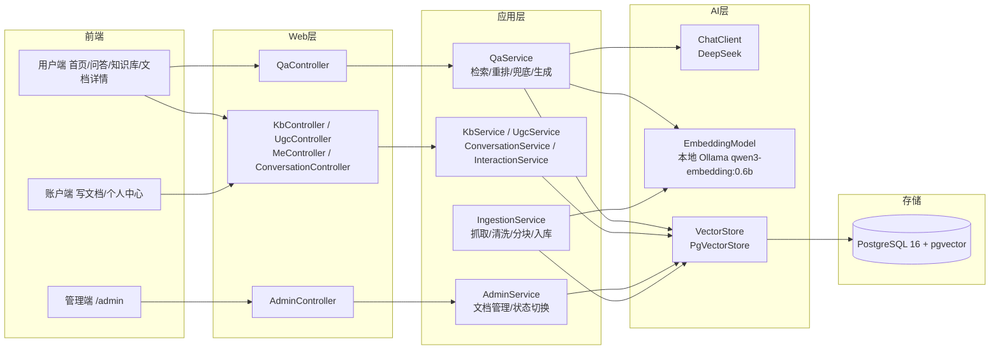

# SpringKB-RAG

面向小型技术团队的**私有化知识库 + RAG 问答系统**：官方文档版本过滤、来源权威性加权、无答案兜底 + 引用溯源三大核心能力之上，扩展知识库导航、UGC 文档沉淀、会话持久化与点赞收藏，单实例 docker compose 即可跑起来。

**版本**：v1.1（2026-10-26）｜ **技术基线**：Spring Boot 4.0.8 + Spring AI 2.0.0 + PostgreSQL 16 + pgvector + Vue 3

---

## 1. 问题背景

开发者在使用 Spring 生态 / Vue 框架时经常遇到三类问题：

1. **版本割裂**：官方文档按版本（`3.x` / `4.2-SNAPSHOT` / `latest`）分站，搜索时无法限定版本，新旧 API 混在一起误导决策；
2. **来源混杂**：搜索引擎同时返回官方文档与 StackOverflow 等社区答案，质量参差，官方权威信息被淹没；
3. **无答案硬编**：知识库没收录的内容，模型倾向"编造"而非坦诚拒绝，且回答不带出处，无法溯源核验。

**目标**：构建一个能对多版本文档进行**版本感知检索**、**权威优先排序**、**可溯源问答**的知识库系统。

## 2. 解决方案：三大能力

### 能力一 · 版本过滤检索

- `version` 参数通过 Spring AI Filter Expression **下推**到 pgvector 查询层（`metadata->>'version' = ? AND metadata->>'active' = 'true'`），禁止先召回后内存过滤；
- 检索恒过滤 `active == 'true'`，文档下线后即时不可召回；
- **注入防护**：含 `'` / 换行 / `;` / `&&` / `||` 的 version 一律拒绝（400），杜绝 Filter Expression 注入。

### 能力二 · 来源权威性加权

- 初检 `topK×3` → 官方文档 `+boost`（默认 0.15，可配置）→ **稳定排序**重排 → 取前 `topK`；
- 社区答案不剔除，仅被官方反超，保留信息完整性；
- Java 稳定排序（TimSort）保证同分保持初检顺序。

### 能力三 · 无答案兜底 + 引用溯源

- 检索最高相似度 < `app.rag.similarity-threshold`（默认 0.65）→ 短路返回「知识库中未找到相关答案」，**零模型调用**，不编造；模型端返回 NO_ANSWER 时同样丢弃引用来源；
- 弱相关来源（相似度低于阈值）在展示层被过滤，答案只带真正支撑结论的引用；
- 命中时 Prompt 强制逐条结论标注 `[1][2][3]` 引用编号 + `（官方）/（社区）` 来源说明；
- 引用按 chunk id 回源 `kb_chunk` 原文 + `kb_document` 元数据（title / version / section / headingPath / snippet）。

### v1.1 新增能力

- **知识库导航**：`GET /api/kb/overview|tree|docs|doc/{id}` —— 产品线 × 版本 × 来源体系树 + 文档详情，回答"知识库里有什么"；
- **来源聚合 + 原文跳转**：同文档多 chunk 合并为一张来源卡，可直接查看文档全文或跳原始站点；
- **UGC 文档沉淀**：`POST /api/ugc/documents` 团队成员可发布 Markdown 文档，自动记录作者归属，进入同一套检索链路；
- **会话持久化**：`kb_conversation` / `kb_message` 表 + `/api/conversations/**`，问答历史跨设备回看；
- **点赞收藏**：`kb_doc_like` / `kb_doc_favorite` + `/api/me/docs/{id}/like|favorite`，轻反馈反哺运营；
- **检索基线测评**：`eval/BaselineEvaluator` 量化检索质量（Hit@10 / Recall@10），替代手工拍参数；
- **本地 Embedding**：向量模型切换为本地 Ollama `qwen3-embedding:0.6b`（多语言，中英检索同空间），导入/检索不再依赖外部 Embedding API。

## 3. 验证结果

| 能力       | 验证用例                                                                                                 | 结果 |
| ---------- | -------------------------------------------------------------------------------------------------------- | ---- |
| 版本过滤   | `createApp`（3.x）仅召回 3.x，双向交叉验证无泄漏                                                       | ✅   |
| 权威性加权 | graceful shutdown（4.2-SNAPSHOT）community 0.6748 被 official 0.6575+0.15 反超，community 保留第 3、4 名 | ✅   |
| 无答案兜底 | 烘焙面包问题 → found=false + 兜底文案，零 Chat 调用                                                     | ✅   |
| 引用溯源   | createApp 回答带 [1][2][3] 引用，编号与 sources 一一对应                                                 | ✅   |

数据规模：**1443 篇真实文档**（官方 1190+：spring-framework 465 / spring-security 156 / spring-boot 73 / spring-ai 80 / spring-data-jpa 35 / vue 80 / vue-router 167 / pinia 97 / vite 39；社区 253：Stack Overflow 251 + 2 注入样本），**3260 chunks / 3262 向量行**（Ollama 重灌）。检索基线：合成查询 Hit@10 = 0.9167；精选问句 Hit@10 = 0.8696 / Recall@10 = 0.8043。自动化测试 **82/82 通过**（分块 / 幂等 / 检索 / 重排 / 兜底 / 管理接口 / 爬虫映射 / 知识库 / UGC / 会话互动 / 基线测评）。完整记录见 [docs/测试用例文档.md](docs/测试用例文档.md) 与 [docs/devlog/](docs/devlog/)。

## 4. 架构图



## 5. 技术栈

| 层   | 技术                          | 说明                                                                          |
| ---- | ----------------------------- | ----------------------------------------------------------------------------- |
| 后端 | Spring Boot 4.0.8（Java 17）  | Jackson 3（tools.jackson）                                                    |
| AI   | Spring AI 2.0.0               | Chat（DeepSeek）+ Embedding（本地 Ollama qwen3-embedding:0.6b，1024 维）+ PgVectorStore |
| 存储 | PostgreSQL 16 + pgvector      | HNSW / 余弦相似度                                                             |
| 认证 | Spring Security 7 + JWT       | 无状态 / BCrypt                                                               |
| 前端 | Vue 3 + Vite 5 + Element Plus | Pinia + Vue Router + axios + marked/DOMPurify（Markdown 安全渲染），独立工程 `frontend/` |
| 部署 | Docker Compose                | `rag-postgres`（63892）+ 一体化 app 镜像                                    |

## 6. 快速启动

```bash
# 1. 启动数据库（PostgreSQL 16 + pgvector，端口 63892）
docker compose up -d

# 2. 配置环境变量
#    DEEPSEEK_API_KEY（Chat 必需）/ JWT_SECRET
#    Embedding 走本地 Ollama，无需外部 API Key：
#    安装 Ollama 后执行  ollama pull qwen3-embedding:0.6b

# 3. 启动后端（8080）
./mvnw spring-boot:run

# 4. 启动前端（5173，/api 代理 → 8080）
cd frontend && npm install && npm run dev

# 5. 灌入真实文档（可选，Embedding 本地免费跑）
./mvnw spring-boot:run -Dspring-boot.run.arguments="--import=all"
```

打开 `http://localhost:5173`：未初始化会进入 Setup 向导（创建管理员账号）；之后首页 / 问答 / 知识库免登录可用，写文档与个人中心需登录，管理后台仅 admin。

## 7. 目录结构

```
springKB/
├── src/main/java/com/guangqian/springkb/
│   ├── controller/      # Auth / Admin / Qa / Kb / Ugc / Me / Conversation 接口层
│   ├── kb/              # 知识库导航与 UGC 发布（KbService / UgcService）
│   ├── me/              # 会话持久化与点赞收藏（ConversationService / InteractionService）
│   ├── eval/            # 检索基线测评（BaselineEvaluator / BaselineRunner / CuratedQuery）
│   ├── service/         # 业务层（AuthService）
│   ├── repository/      # 数据访问层
│   ├── entity/          # 实体
│   ├── dto/             # 请求/响应对象
│   ├── security/        # JWT 工具与过滤器 + CurrentUser
│   ├── config/          # SecurityConfig / ChatClientConfig / SpaFallbackConfig
│   ├── crawler/         # 文档爬虫（10 个源适配器：Spring 全家桶 / Vue 生态 / Stack Overflow）
│   ├── ingestion/       # 导入链路（ChunkSplitter / IngestionService / ImportRunner）
│   ├── rag/             # 检索 / 重排 / 兜底 / 问答（QaService / RagSearchService / Reranker / RagTraceService）
│   ├── manage/          # 管理接口（AdminService）
│   ├── common/          # 统一响应 ApiResponse / OriginalUrlResolver
│   └── demo/            # 种子数据
├── frontend/            # Vue 3 前端（Setup / Home / QaHome / KbHome / KbDoc / Editor / Me / Login 八页面）
├── demo.html            # v2 高保真原型（8 视图，设计基准）
├── docs/                # 详细设计（v1 + v2）/ v2 产品规划 / 测试用例 / devlog 开发日志
└── data/raw/            # 爬虫文档快照（已 gitignore）
```

## 8. 测试

```bash
./mvnw test    # 82 例全量通过（真实 Postgres 测试库 springkb_test + 确定性 mock Embedding）
```

| 测试类                           | 用例数 | 覆盖                                                         |
| -------------------------------- | ------ | ------------------------------------------------------------ |
| ChunkSplitterTest                | 8      | 分块边界 / 代码围栏 / `$` 与反斜杠内容清洗                 |
| IngestionServiceTest + BatchTest | 5      | 幂等 / 双字段一致 / 向量对齐 / 分批上限                      |
| RagSearchServiceTest             | 7      | 版本过滤 / 下推证明 / inactive / 注入防护                    |
| RerankerTest                     | 5      | official 排前 / 同分稳定 / 溢出 / 空候选                     |
| QaServiceTest + Fallback 等      | 8      | 兜底零调用 / 引用对齐 / 越界保护 / 阈值参数化 / 弱引用过滤 / 模型 NO_ANSWER 丢引用 |
| AdminApiTest                     | 9      | 未登录 401 / 导入幂等 / active 双写 / SSRF 白名单 / 删除级联 |
| 爬虫映射与抓取                   | 10+    | 10 源 adapter 字段映射 / Stack Overflow 抓取                 |
| Kb / Ugc / Me / 会话互动         | 20+    | 体系树 / 文档详情 / UGC 归属 / 会话持久化 / 点赞收藏幂等     |
| BaselineEvaluatorTest 等         | 若干   | 基线测评 / 应用上下文 / 契约                                 |

## 9. 已知限制

1. **boost 是微调非覆盖**：community 与查询语义过近（相似度差 > 0.15）时官方无法反超，属设计边界（vue reactive array 场景如实记录）。
2. **固定 token 分块**：按标题栈 500~1000 token 贪心分块，未做语义分块。
3. **阈值/boost 半手工调参**：已有 BaselineEvaluator 量化基线（Hit@10 / Recall@10），但未做网格搜索寻优。
4. **Embedding 维度一锤子买卖**：qwen3-embedding:0.6b = 1024 维，换模型必须重建向量库并重新入库（10-26 已完成一次百炼 → Ollama 全量重灌，1443 文档 0 失败）。
5. **URL 抓取白名单**：手动导入仅限 `vuejs.org` / `spring.io`（防 SSRF），其他域名需走本地 JSON 导入。
6. **单实例单团队**：私有化部署模型，实例间隔离靠部署边界；不做多租户、跨团队公共区（架构决策见 v2 文档）。
7. **规模边界**：当前数据量远低于 pgvector 上限；未来千万级需评估迁移 Qdrant / Milvus。

## 10. 相关文档

- [详细设计（v1）](./docs/详细设计.md) ｜ [详细设计 v2](./docs/详细设计_v2.md)（私有化单实例方向定稿）
- [v2 产品规划](./docs/v2产品规划.md)
- [测试用例文档](./docs/测试用例文档.md)
- [开发日志](./docs/devlog/)
- [项目计划书](./docs/项目计划书.md)
- [demo.html](./demo.html)（v2 前端高保真原型，浏览器直接打开）
