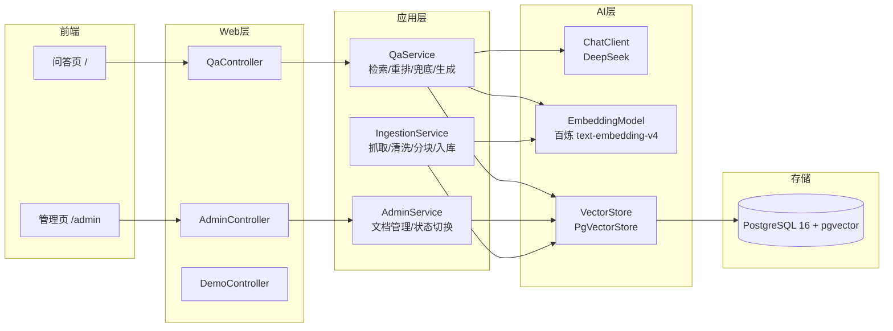

# SpringKB-RAG

Spring 生态 + RAG 的知识库问答系统：面向官方文档版本割裂与社区答案混杂场景，提供**版本过滤**、**来源权威性加权**、**无答案兜底 + 引用溯源** 三大能力。

**版本**：v1.0（2026-10-20）｜ **技术基线**：Spring Boot 4.0.8 + Spring AI 2.0.0 + PostgreSQL 16 + pgvector + Vue 3

---

## 1. 问题背景

开发者在使用 Spring 生态 / Vue 框架时经常遇到三类问题：

1. **版本割裂**：官方文档按版本（`3.x` / `4.2-SNAPSHOT` / `latest`）分站，搜索时无法限定版本，新旧 API 混在一起误导决策；
2. **来源混杂**：搜索引擎同时返回官方文档与 StackOverflow 等社区答案，质量参差，官方权威信息被淹没；
3. **无答案硬编**：知识库没收录的内容，模型倾向"编造"而非坦诚拒绝，且回答不带出处，无法溯源核验。

**目标**：构建一个能对多版本文档进行**版本感知检索**、**权威优先排序**、**可溯源问答**的知识库系统。

## 2. 解决方案：三大能力

### 能力一 · 版本过滤检索

- `version` 参数通过 Spring AI Filter Expression **下推**到 pgvector 查询层（`metadata->>'version' = ? AND metadata->>'active' = 'true'`），禁止先召回后内存过滤；
- 检索恒过滤 `active == 'true'`，文档下线后即时不可召回；
- **注入防护**：含 `'` / 换行 / `;` / `&&` / `||` 的 version 一律拒绝（400），杜绝 Filter Expression 注入。

### 能力二 · 来源权威性加权

- 初检 `topK×3` → 官方文档 `+boost`（默认 0.15，可配置）→ **稳定排序**重排 → 取前 `topK`；
- 社区答案不剔除，仅被官方反超，保留信息完整性；
- Java 稳定排序（TimSort）保证同分保持初检顺序。

### 能力三 · 无答案兜底 + 引用溯源

- 检索最高相似度 < `app.rag.similarity-threshold`（默认 0.65）→ 短路返回「知识库中未找到相关答案」，**零模型调用**，不编造；
- 命中时 Prompt 强制逐条结论标注 `[1][2][3]` 引用编号 + `（官方）/（社区）` 来源说明；
- 引用按 chunk id 回源 `kb_chunk` 原文 + `kb_document` 元数据（title / version / section / headingPath / snippet）。

## 3. 验证结果

| 能力 | 验证用例 | 结果 |
| --- | --- | --- |
| 版本过滤 | `createApp`（3.x）仅召回 3.x，双向交叉验证无泄漏 | ✅ |
| 权威性加权 | graceful shutdown（4.2-SNAPSHOT）community 0.6748 被 official 0.6575+0.15 反超，community 保留第 3、4 名 | ✅ |
| 无答案兜底 | 烘焙面包问题 → found=false + 兜底文案，零 Chat 调用 | ✅ |
| 引用溯源 | createApp 回答带 [1][2][3] 引用，编号与 sources 一一对应 | ✅ |

数据规模：**235 篇真实文档**（vue 80 / spring-ai 80 / spring-boot 73 官方 + 2 社区样本），**854 chunks / 856 向量行**。自动化测试 **42/42 通过**（分块 / 幂等 / 检索 / 重排 / 兜底 / 管理接口）。完整记录见 [docs/测试用例文档.md](docs/测试用例文档.md) 与 [docs/devlog/](docs/devlog/)。

## 4. 架构图



## 5. 技术栈

| 层 | 技术 | 说明 |
| --- | --- | --- |
| 后端 | Spring Boot 4.0.8（Java 17） | Jackson 3（tools.jackson） |
| AI | Spring AI 2.0.0 | Chat（DeepSeek）+ Embedding（百炼 text-embedding-v4，1024 维）+ PgVectorStore |
| 存储 | PostgreSQL 16 + pgvector | HNSW / 余弦相似度 |
| 认证 | Spring Security 7 + JWT | 无状态 / BCrypt |
| 前端 | Vue 3 + Vite 5 + Element Plus | Pinia + Vue Router + axios，独立工程 `frontend/` |
| 部署 | Docker Compose | `rag-postgres`（63892） |

## 6. 快速启动

```bash
# 1. 启动数据库（PostgreSQL 16 + pgvector，端口 63892）
docker compose up -d

# 2. 配置环境变量
#    DEEPSEEK_API_KEY / DASHSCOPE_API_KEY（百炼）/ JWT_SECRET

# 3. 启动后端（8080）
./mvnw spring-boot:run

# 4. 启动前端（5173，/api 代理 → 8080）
cd frontend && npm install && npm run dev

# 5. 灌入真实文档（可选，需 DASHSCOPE_API_KEY）
./mvnw spring-boot:run -Dspring-boot.run.arguments="--import=all"
```

登录管理端（`http://localhost:5173`）→ 文档列表 / 导入 / 启用停用；问答页直接提问。

## 7. 目录结构

```
springKB/
├── src/main/java/com/guangqian/springkb/
│   ├── controller/      # Auth / Admin / Qa / Demo 接口层
│   ├── service/         # 业务层（AuthService）
│   ├── repository/      # 数据访问层
│   ├── entity/          # 实体
│   ├── dto/             # 请求/响应对象
│   ├── security/        # JWT 工具与过滤器
│   ├── config/          # SecurityConfig / ChatClientConfig
│   ├── crawler/         # 文档爬虫（Vue / SpringAI / SpringBoot 三源适配器）
│   ├── ingestion/       # 导入链路（ChunkSplitter / IngestionService / ImportRunner）
│   ├── rag/             # 检索 / 重排 / 兜底 / 问答（QaService / RagSearchService / Reranker）
│   ├── manage/          # 管理接口（AdminService / AdminController）
│   ├── common/          # 统一响应 ApiResponse
│   └── demo/            # 种子数据
├── frontend/            # Vue 3 管理端
├── docs/                # 详细设计 / 测试用例 / devlog 开发日志
└── data/raw/            # 爬虫文档快照（已 gitignore）
```

## 8. 测试

```bash
./mvnw test    # 42 例全量通过（真实 Postgres 测试库 springkb_test + 确定性 mock Embedding）
```

| 测试类 | 用例数 | 覆盖 |
| --- | --- | --- |
| ChunkSplitterTest | 8 | 分块边界 / 代码围栏 / `$` 与反斜杠内容清洗 |
| IngestionServiceTest + BatchTest | 5 | 幂等 / 双字段一致 / 向量对齐 / 分批上限 |
| RagSearchServiceTest | 7 | 版本过滤 / 下推证明 / inactive / 注入防护 |
| RerankerTest | 5 | official 排前 / 同分稳定 / 溢出 / 空候选 |
| QaServiceTest + Fallback | 6 | 兜底零调用 / 引用对齐 / 越界保护 / 阈值参数化 |
| AdminApiTest | 9 | 未登录 401 / 导入幂等 / active 双写 / SSRF 白名单 / 删除级联 |
| 其他（context 等） | 2 | 应用上下文 / 契约 |

## 9. 已知限制

1. **boost 是微调非覆盖**：community 与查询语义过近（相似度差 > 0.15）时官方无法反超，属设计边界（vue reactive array 场景如实记录）。
2. **固定 token 分块**：按标题栈 500~1000 token 贪心分块，未做语义分块。
3. **阈值/boost 手工调参**：基于少量用例验证，未网格搜索。
4. **Embedding 维度一锤子买卖**：text-embedding-v4 = 1024 维，换模型必须重建向量库并重新入库。
5. **URL 抓取白名单**：手动导入仅限 `vuejs.org` / `spring.io`（防 SSRF），其他域名需走本地 JSON 导入。
6. **规模边界**：当前数据量远低于 pgvector 上限；未来千万级需评估迁移 Qdrant / Milvus。

## 10. 相关文档

- [详细设计](./docs/详细设计.md)
- [测试用例文档](./docs/测试用例文档.md)
- [开发日志](./docs/devlog/)
- [项目计划书](./docs/项目计划书.md)
